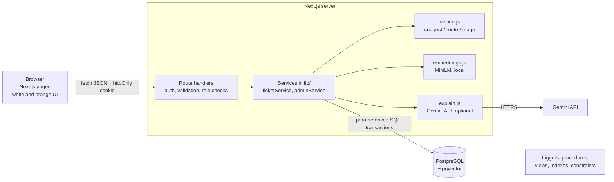

# Architecture

## Layers



| Layer | Responsibility | Where |
|---|---|---|
| Presentation | Pages, forms, role-based navigation | `app/**/page.js`, `components/` |
| API | Authentication, input validation, role and ownership checks, error mapping | `app/api/**/route.js`, `lib/auth.js`, `lib/validate.js`, `lib/errors.js` |
| Services | Business flow: create ticket, resolve, feedback, reopen, withdraw, admin actions | `lib/ticketService.js`, `lib/adminService.js` |
| AI | Embedding, similarity query, decision logic, Gemini explanation | `lib/embeddings.js`, `lib/similarity.js`, `lib/decide.js`, `lib/explain.js` |
| Data | Integrity, audit, assignment, SLA, vector search | `db/*.sql` |

Rules that keep it clean: pages never touch the database; route handlers hold no business logic; `decide.js` is a pure function (easy to test); every rule that must not be skipped (SLA deadline, audit trail, assignment lock, validation) lives in the database, not in JavaScript.

## Submitting a ticket

```mermaid
sequenceDiagram
  participant E as Employee (browser)
  participant R as POST /api/tickets
  participant M as MiniLM (local)
  participant P as PostgreSQL + pgvector
  participant G as Gemini API
  E->>R: description, priority
  R->>R: check cookie, role, validate input
  R->>M: embed(description)
  M-->>R: 384 numbers
  R->>P: top 5 verified resolved tickets (cosine)
  P-->>R: neighbours + similarity
  R->>R: decide(): suggest / route / triage
  R->>P: BEGIN; INSERT ticket (trigger sets SLA); INSERT suggestion; SAVEPOINT; CALL assign_technician; COMMIT
  R-->>E: ticket, department, technician, suggested fix
  E->>R: POST /api/tickets/id/explanation
  R->>P: load top retrieved tickets
  R->>G: grounded prompt (personal data removed)
  G-->>R: explanation
  R->>R: accept only if it cites supplied tickets
  R->>P: cache explanation
  R-->>E: AI explanation (or nothing: raw fix is already shown)
```

If the embedding step, the search or Gemini fails, the ticket is still saved (it goes to triage) or the raw past fix is shown. The AI layer never blocks ticket creation.

## One search, three outcomes

| Best similarity | Mode | What happens |
|---|---|---|
| at or above `SIM_HIGH` | suggest | Past fix shown with source ticket and score; routed to that fix's department |
| between `SIM_MID` and `SIM_HIGH`, and one department holds at least half of the weighted vote | route | No fix shown; routed by similarity-weighted vote of the neighbours |
| below `SIM_MID`, a split vote, or the AI step failed | triage | Goes to the Admin triage queue |

## Vector data model

- **What is embedded:** the ticket description (`tickets.description`).
- **Model:** `Xenova/all-MiniLM-L6-v2` (pre-trained, 384 dimensions, normalised), run locally. An offline lexical fallback exists for tests only (`EMBEDDING_PROVIDER=hash`).
- **Storage:** `tickets.embedding vector(384)` plus a partial HNSW index over verified resolved tickets.
- **Metric:** cosine similarity (pgvector `<=>` returns cosine distance; similarity = 1 minus distance).
- **Retrieval:** nearest 5 verified resolved tickets, then `decide()`; the top 3 are passed to Gemini for the explanation.
- **Learning loop:** a technician's resolution marks the ticket verified, so it becomes searchable; a reopen clears the flag so a wrong fix stops being suggested.

## Security design

Passwords: bcrypt. Sessions: signed token in an httpOnly, SameSite cookie (8 h); the user row is re-read on every request so deactivation and role changes apply immediately. Authorization: role and ownership checks on the server for every route; a ticket you may not see returns 404. SQL: parameterized queries only. CSRF: SameSite cookie plus an Origin check on state-changing requests. Secrets: environment variables only. Database: the app connects as a restricted role (`db/roles.sql`). LLM: personal data is removed before sending, ticket text is treated as data, and the answer is accepted only if it cites tickets that were supplied.
